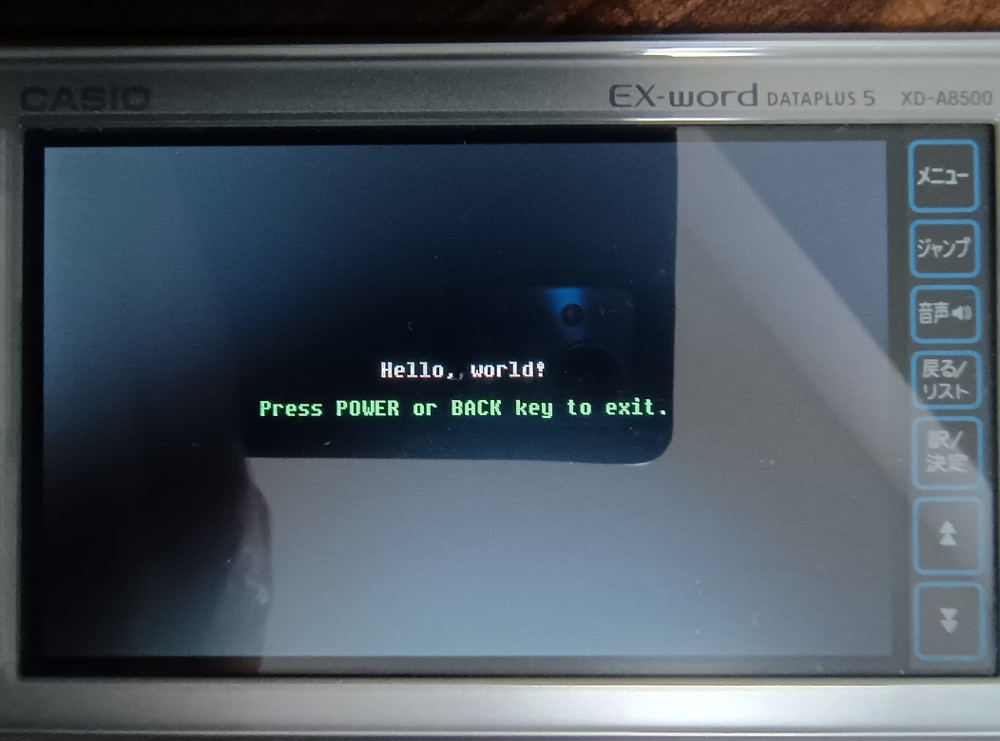

# CASIO EX-word DATAPLUS 5/6/7 Project Skeleton



This repository is a skeleton for developing homebrews (addons) for CASIO EX-word DATAPLUS 5/6/7 with GitHub Actions build on tag push and manual dispatch. `src/main.c` in this repository shows `Hello, world!` in white text on black background, and exits on Power or Back key press. You can install your app to your EX-word device in the same way as [Gnuboy EX](https://brain.fandom.com/ja/wiki/Gnuboy_EX) by using [libexword](https://brain.fandom.com/ja/wiki/Libexword) tool. For local setup, install [devkitSH4](https://brain.fandom.com/ja/wiki/devkitSH4) compiler and invoke `make` to build in `build/ja/` and `build/cn/`. devkitSH4 automatically downloads [libdataplus](https://github.com/brijohn/libdataplus) during the installation process.

- `html/`: Metadata HTML templates to be read by the EX-word system (must be in CRLF)
- `src/`: C source files
  - `src/libc/`: libc subset implementation found in [Gnuboy EX](https://github.com/brijohn/gnuboy-ex)

App name etc. are set in `TARGET`, `MODNAME`, `APPTITLE`, and `APPID` in `Makefile`. `APPTITLE` is the app name displayed on EX-word, and `APPID` is the app-specific identifier (5 uppercase letters). The details of the others are currently unknown.

As this repository is based on GPL-2.0 licensed [Gnuboy EX](https://github.com/brijohn/gnuboy-ex), we license this repository in [GPL-2.0](COPYING) as required.

This repository is inspired by [yukkuri-Dev/EXtend-Word](https://github.com/yukkuri-Dev/EXtend-Word), and the automatic build uses a prebuilt toolchain distributed at [MaxSignal/buildscripts](https://github.com/MaxSignal/buildscripts).

## Experimental compiler: Hollyhock SH4A GCC

A separate [Hollyhock SH4 experiment](https://github.com/TheRainbowPhoenix/exword-xd-a8500-TEST/actions/workflows/hollyhock-sh4.yml)
tries the modern `sh4a_nofpueb-elf-gcc` from the
[Hollyhock 3 container](https://github.com/ClasspadDev/hollyhock-3).
It uses [`Makefile.hollyhock`](Makefile.hollyhock), a dedicated EX-word
linker script/startup stub, and legacy libdataplus/`elf2d01`.
See [the experiment's design and limitations](docs/hollyhock-experiment.md).
**Experimental builds are not yet hardware-tested.** The default build is unchanged.

## Download a build (ZIP, no GitHub Release needed)

The [Build workflow](https://github.com/TheRainbowPhoenix/exword-xd-a8500-TEST/actions/workflows/build.yml)
runs for every push to `main`, for pull requests, and when started manually
from **Actions → Build → Run workflow**.

Open a **successful workflow run**, scroll down to **Artifacts**, and download
one of these ZIP archives:

- **`exword-xd-a8500-ja`** — Japanese EX-word package
- **`exword-xd-a8500-cn`** — Chinese EX-word package

Both contain an `XDTST/` directory with `xdtest.d01`, `diction.htm`,
`fileinfo.cji` and the other device metadata files.

Unzip your chosen archive so you have `XDTST/` in the working directory
from which you launch libexword. With your EX-word in Library communication
mode and connected through libexword, run:

```text
connect
setpath mem:///
dict auth YOUR_USERNAME YOUR_0xKEY
dict install XDTST
```

If already connected, skip `connect`; if already authenticated, skip
`dict auth`. You can use internal memory **without an SD card**.

> **Warning:** Do not run `dict reset` just to install this test app.
> Resetting authentication deletes previously installed add-on dictionaries.
> Use an existing authentication key whenever possible.

Artifacts are kept for **30 days** by the workflow. GitHub may ask you
to sign in to download them. These are *GitHub Actions artifacts*, not releases.

### 日本語: ZIP のダウンロード

[Actions → Build](https://github.com/TheRainbowPhoenix/exword-xd-a8500-TEST/actions/workflows/build.yml)
から成功した実行を開き、**Artifacts** の
`exword-xd-a8500-ja` をダウンロードしてください。
ZIP を展開するとインストール用 `XDTST/` フォルダがあります。
`dict install XDTST` で追加辞書としてインストールできます
（事前に接続・認証が必要）。SD カードは不要です。
**`dict reset` は既存の追加辞書を削除するため、安易に実行しないでください。**

---

このリポジトリは CASIO 製電子辞書 EX-word の DATAPLUS 5/6/7 で動作するプログラム（追加コンテンツ）を開発するためのテンプレートで、tag の push や手動発行で GitHub Actions ビルドも走ります。同梱の `src/main.c` は、黒背景に白文字で `Hello, world!` と表示し、電源ボタンか戻るボタンで終了するものです。[libexword](https://brain.fandom.com/ja/wiki/Libexword) ツールを使えば [Gnuboy EX](https://brain.fandom.com/ja/wiki/Gnuboy_EX) と同様の方法で EX-word にインストールできます。ローカル環境では、[devkitSH4](https://brain.fandom.com/ja/wiki/devkitSH4) コンパイラを導入して `make` すると `build/ja/` と `build/cn/` 以下にビルドされます。devkitSH4 のインストール時に [libdataplus](https://github.com/brijohn/libdataplus) も同時にインストールされます。

- `html/`: EX-word システムが使用するメタデータを記載した HTML テンプレート（CRLF 必須）
- `src/`: C ソースファイル
  - `src/libc/`: [Gnuboy EX](https://github.com/brijohn/gnuboy-ex) に含まれる libc のサブセット実装

アプリ名などは `Makefile` の `TARGET`, `MODNAME`, `APPTITLE`, `APPID` で設定されています。`APPTITLE` が EX-word 上で表示されるアプリ名、`APPID` がアプリ固有の識別子（英大文字 5 文字）ですが、それ以外は現時点で詳細不明です。

GPL-2.0 でライセンスされている [Gnuboy EX](https://github.com/brijohn/gnuboy-ex) プロジェクトをベースに作成しているため、その規定に従い本リポジトリも [GPL-2.0](COPYING) でライセンスします。

本リポジトリは [yukkuri-Dev/EXtend-Word](https://github.com/yukkuri-Dev/EXtend-Word) に着想を得ており、自動ビルドは [MaxSignal/buildscripts](https://github.com/MaxSignal/buildscripts) で配布されているビルド済みツールチェインを使用しています。
